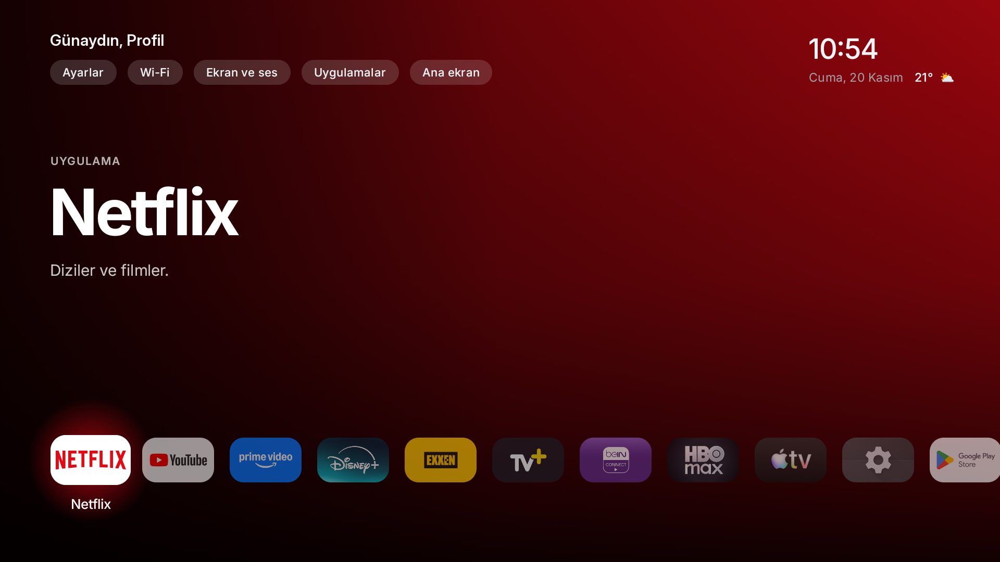
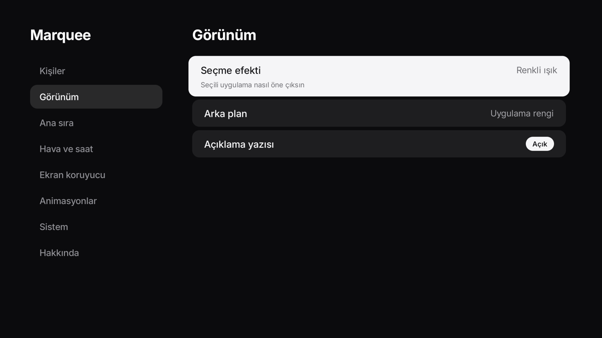
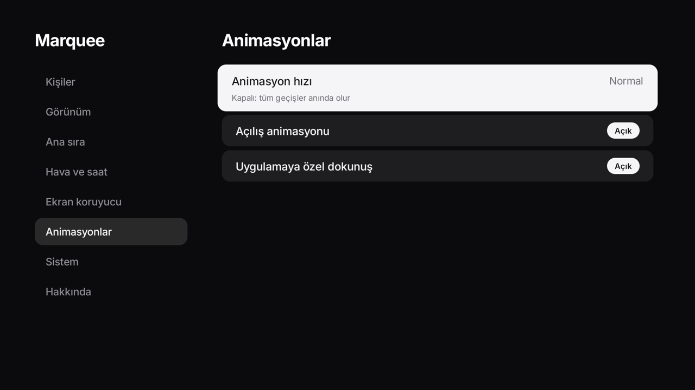
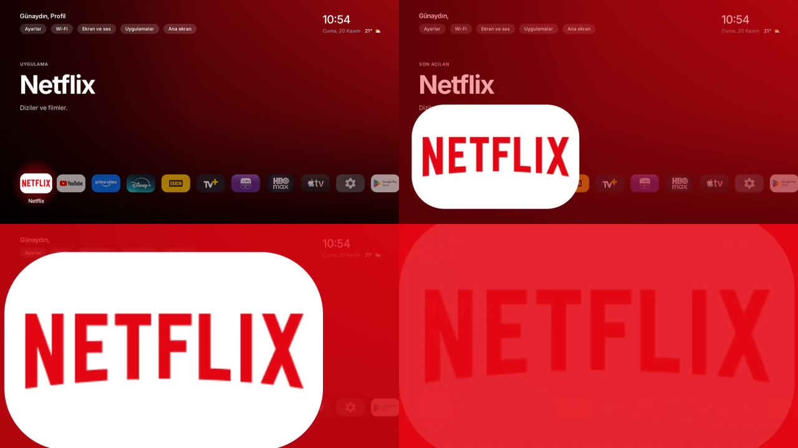
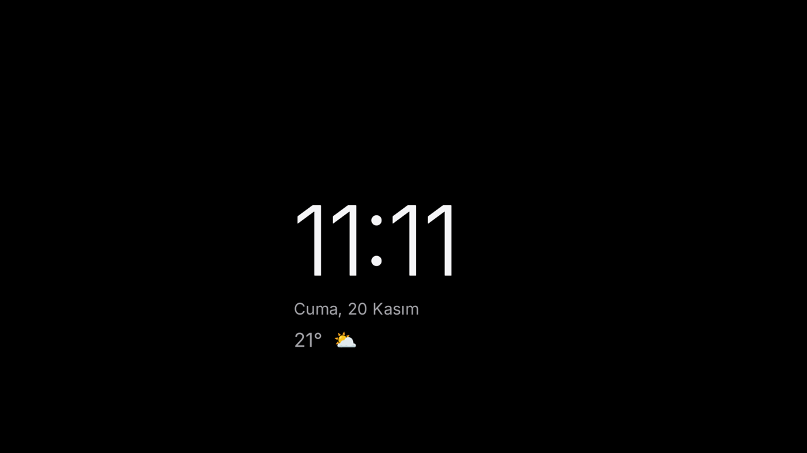

# Marquee

A calm, full-screen home screen for Google TV and Android TV. One row of your apps, the focused app's colour washing over the screen, a greeting, the weather, and nothing else: no ads, no suggestions, no rows of things you didn't ask for.

Plain Java, no Gradle, no libraries, about 550 KB.



| Settings | Animations |
|---|---|
|  |  |
| **Launch animation** | **Screensaver** |
|  |  |

**[Download the latest APK](https://github.com/ardaemirokutan/marquee/releases/latest/download/marquee.apk)** · [Türkçe](#türkçe)

## Features

- **One row of apps.** The focused app's colour (taken from its banner) fills the background and the banner glows in that colour. Other focus styles: lift, or a plain white ring.
- **App name and a short description** above the row for well-known streaming apps.
- **Greeting** ("Good morning, Alex"), quick buttons for Settings, Wi‑Fi, Display & sound and Apps, and top right the clock, date and weather.
- **Weather** from [Open-Meteo](https://open-meteo.com) (free, no key). Type your city in settings; leave it empty to hide the weather.
- **People.** Each person has their own hidden apps and app order. Switch person in settings.
- **Screensaver.** After 2, 5 or 10 idle minutes: a big clock, date and weather on black, moving a little each minute so nothing burns in. Any key wakes it.
- **Hold OK on an app:** move to front, hide, app info, uninstall. Remembers the last opened app.
- **Animations, all switchable:** the banner grows to fill the screen when you open an app, a soft light in the app's own colour crosses the focused banner, and animation speed Normal / Fast / Off.
- **Built for weak TV hardware:** only transform and alpha animations, no blur, colours worked out once per app on a background thread, the background baked into one small bitmap.
- **English and Turkish**, following the device language.

## Install

You need a computer on the same Wi‑Fi as the TV, and [adb](https://developer.android.com/tools/releases/platform-tools) (Android platform tools).

1. **Turn on developer options on the TV:** Settings → System → About → press OK on *Android TV OS build* seven times.
2. **Turn on wireless debugging:** Settings → System → Developer options → Wireless debugging → on, then *Pair device with pairing code*. Leave that screen open; it shows a code and an `IP:port`.
3. **Pair and connect** from the computer (use the numbers on your TV):
   ```sh
   adb pair 192.168.1.20:37000 123456        # IP:port and code from the pairing screen
   adb connect 192.168.1.20:41000            # IP:port shown on the Wireless debugging screen itself
   ```
4. **Install Marquee and make it the home screen:**
   ```sh
   adb install -r marquee.apk
   adb shell cmd package set-home-activity com.arda.marquee/.Home
   adb shell settings put secure enabled_accessibility_services com.arda.marquee/com.arda.marquee.HomeWatch
   ```
5. Press **Home** on the remote. Open **Home screen** (the last button at the top) to set your name, city and the rest.

Why the accessibility service: Google TV keeps the Home button for its own launcher, so choosing another home app is not enough. `HomeWatch` only listens for "a window came to the front" from the Google TV launcher packages and then brings Marquee forward. It cannot read anything on screen (`canRetrieveWindowContent="false"`). You may see the Google TV home for a moment before Marquee appears.

`settings put secure enabled_accessibility_services` replaces the whole list. If you already use another accessibility service, add it with `:` between entries (see the current list with `adb shell settings get secure enabled_accessibility_services`).

## Install with an AI assistant

If you use an AI coding assistant that can run commands on your computer (Claude Code, for example), do steps 1 and 2 above on the TV, then paste this:

```text
Install the Marquee launcher on my Google TV over wireless adb.
1. If adb is not installed, install Android platform-tools for my OS.
2. Download https://github.com/ardaemirokutan/marquee/releases/latest/download/marquee.apk
3. Ask me for the pairing code and IP:port on the TV's "Pair device with pairing code" screen, then run adb pair.
   Find the connect port with `adb mdns services` (or ask me for the IP:port on the Wireless debugging screen) and run adb connect.
4. Show me the current accessibility services (adb shell settings get secure enabled_accessibility_services) before changing them,
   and keep any that are already there.
5. Run: adb install -r marquee.apk
        adb shell cmd package set-home-activity com.arda.marquee/.Home
        adb shell settings put secure enabled_accessibility_services <existing list>:com.arda.marquee/com.arda.marquee.HomeWatch
6. Press Home (adb shell input keyevent KEYCODE_HOME) and confirm with
   adb shell dumpsys window | grep mCurrentFocus that com.arda.marquee is in front.
Do not change any other TV setting.
```

## Uninstall

```sh
adb shell settings delete secure enabled_accessibility_services   # or put back your previous list
adb uninstall com.arda.marquee
```

The TV goes back to the Google TV home.

## Build from source

Needs JDK 17+ (built with 21), the Android SDK with platform `android-34` and build-tools `34.0.0`, and Python 3.

```sh
cp local.env.example local.env   # set JAVA_HOME and ANDROID_HOME (or export them)
sh build.sh                      # Git Bash on Windows, or any POSIX shell
```

The result is `out/marquee.apk`. Without `KEYSTORE_PASS` it is signed with a debug key created in `.keystore/`. To sign with your own key set `KEYSTORE`, `KEYSTORE_PASS` and, if the alias is not `marquee`, `KEY_ALIAS`. Keep using the same key, or Android refuses to update an installed copy.

The font is [Inter](https://github.com/rsms/inter) (SIL Open Font License, `assets/OFL.txt`). App banners are read from the installed apps at run time; no app logos ship with Marquee. Marquee is MIT licensed (`LICENSE`).

---

## Türkçe

Google TV ve Android TV için sakin, tam ekran bir ana ekran. Tek sıra uygulama, seçili uygulamanın rengiyle dolan ekran, bir selam, hava durumu ve başka hiçbir şey: reklam yok, öneri yok, istemediğin satırlar yok.

Düz Java; Gradle ve kütüphane yok, yaklaşık 550 KB.

**[Son APK'yı indir](https://github.com/ardaemirokutan/marquee/releases/latest/download/marquee.apk)**

### Özellikler

- **Tek sıra uygulama.** Seçili uygulamanın rengi (banner'ından alınır) arka planı doldurur, banner o renkte parlar. Diğer seçim efektleri: yükselme ya da sade beyaz çerçeve.
- **Uygulama adı ve kısa açıklama:** bilinen yayın uygulamaları için sıranın üstünde.
- **Selam** ("Günaydın, Ayşe"), Ayarlar, Wi‑Fi, Ekran ve ses, Uygulamalar kısayolları; sağ üstte saat, tarih ve hava durumu.
- **Hava durumu** [Open-Meteo](https://open-meteo.com)'dan (ücretsiz, anahtar gerekmez). Ayarlardan şehrini yaz; boş bırakırsan gizlenir.
- **Kişiler.** Her kişinin kendi gizli uygulamaları ve uygulama sırası var. Kişiyi ayarlardan değiştir.
- **Ekran koruyucu.** 2, 5 ya da 10 dakika boşta kalınca siyah ekranda büyük saat, tarih ve hava; ekran yanmasın diye dakikada bir hafifçe yer değiştirir. Herhangi bir tuş kapatır.
- **Uygulamada OK'a uzun bas:** başa taşı, gizle, uygulama bilgisi, kaldır. Son açılan uygulamayı hatırlar.
- **Animasyonlar, hepsi kapatılabilir:** uygulama açılırken banner büyüyüp ekranı doldurur, seçili banner'ın üstünden uygulamanın kendi renginde yumuşak bir ışık geçer, animasyon hızı Normal / Hızlı / Kapalı.
- **Zayıf TV donanımı için yapıldı:** yalnız konum/ölçek/saydamlık animasyonu, bulanıklık yok, renkler her uygulama için bir kez arka planda hesaplanır, arka plan tek küçük bir resimde.
- **Türkçe ve İngilizce**, cihazın dilini izler.

### Kurulum

TV ile aynı Wi‑Fi'da bir bilgisayar ve [adb](https://developer.android.com/tools/releases/platform-tools) (Android platform tools) gerekir.

1. **TV'de geliştirici seçeneklerini aç:** Ayarlar → Sistem → Hakkında → *Android TV OS derlemesi* üzerinde OK'a yedi kez bas.
2. **Kablosuz hata ayıklamayı aç:** Ayarlar → Sistem → Geliştirici seçenekleri → Kablosuz hata ayıklama → açık, sonra *Cihazı eşleme koduyla eşle*. Bu ekranı açık bırak; bir kod ve `IP:port` gösterir.
3. **Bilgisayardan eşle ve bağlan** (TV'deki sayıları kullan):
   ```sh
   adb pair 192.168.1.20:37000 123456        # eşleme ekranındaki IP:port ve kod
   adb connect 192.168.1.20:41000            # Kablosuz hata ayıklama ekranının kendisindeki IP:port
   ```
4. **Marquee'yı kur ve ana ekran yap:**
   ```sh
   adb install -r marquee.apk
   adb shell cmd package set-home-activity com.arda.marquee/.Home
   adb shell settings put secure enabled_accessibility_services com.arda.marquee/com.arda.marquee.HomeWatch
   ```
5. Kumandada **Home**'a bas. Adını, şehrini ve gerisini ayarlamak için üstteki son düğmeyi (**Ana ekran**) aç.

Erişilebilirlik servisi neden var: Google TV, Home tuşunu kendi ana ekranına ayırır; başka bir ana uygulama seçmek yetmez. `HomeWatch` yalnız Google TV ana ekran paketlerinden gelen "öne pencere geldi" olayını dinler ve Marquee'yı öne getirir. Ekrandaki hiçbir şeyi okuyamaz (`canRetrieveWindowContent="false"`). Marquee gelmeden önce Google TV ana ekranı bir an görünebilir.

`settings put secure enabled_accessibility_services` listenin tamamını değiştirir. Başka bir erişilebilirlik servisi kullanıyorsan onu da `:` ile ekle (şu anki liste: `adb shell settings get secure enabled_accessibility_services`).

### Yapay zekâ asistanıyla kurulum

Bilgisayarında komut çalıştırabilen bir yapay zekâ kod asistanı kullanıyorsan (örneğin Claude Code), TV'de yukarıdaki 1. ve 2. adımı yap, sonra şunu yapıştır:

```text
Google TV'me kablosuz adb ile Marquee ana ekranını kur.
1. adb kurulu değilse işletim sistemime uygun Android platform-tools'u kur.
2. https://github.com/ardaemirokutan/marquee/releases/latest/download/marquee.apk dosyasını indir.
3. TV'deki "Cihazı eşleme koduyla eşle" ekranındaki kodu ve IP:port'u bana sor, adb pair çalıştır.
   Bağlantı portunu `adb mdns services` ile bul (ya da Kablosuz hata ayıklama ekranındaki IP:port'u bana sor), adb connect çalıştır.
4. Değiştirmeden önce mevcut erişilebilirlik servislerini göster
   (adb shell settings get secure enabled_accessibility_services) ve var olanları koru.
5. Çalıştır: adb install -r marquee.apk
             adb shell cmd package set-home-activity com.arda.marquee/.Home
             adb shell settings put secure enabled_accessibility_services <mevcut liste>:com.arda.marquee/com.arda.marquee.HomeWatch
6. Home'a bas (adb shell input keyevent KEYCODE_HOME) ve
   adb shell dumpsys window | grep mCurrentFocus ile önde com.arda.marquee olduğunu doğrula.
TV'nin başka hiçbir ayarını değiştirme.
```

### Kaldırma

```sh
adb shell settings delete secure enabled_accessibility_services   # ya da önceki listeni geri yaz
adb uninstall com.arda.marquee
```

TV, Google TV ana ekranına döner.

### Kaynaktan derleme

JDK 17+ (21 ile derlendi), `android-34` platformu ve `34.0.0` build-tools içeren Android SDK ve Python 3 gerekir.

```sh
cp local.env.example local.env   # JAVA_HOME ve ANDROID_HOME'u yaz (ya da export et)
sh build.sh                      # Windows'ta Git Bash
```

Çıktı `out/marquee.apk`. `KEYSTORE_PASS` yoksa `.keystore/` altında oluşturulan debug anahtarıyla imzalanır. Kendi anahtarın için `KEYSTORE`, `KEYSTORE_PASS` ve alias `marquee` değilse `KEY_ALIAS` ver. Hep aynı anahtarı kullan; yoksa Android kurulu sürümün üstüne güncellemeyi reddeder.

Yazı tipi [Inter](https://github.com/rsms/inter) (SIL Open Font License, `assets/OFL.txt`). Uygulama banner'ları çalışırken yüklü uygulamalardan okunur; Marquee'yla birlikte uygulama logosu dağıtılmaz. Marquee MIT lisanslıdır (`LICENSE`).
